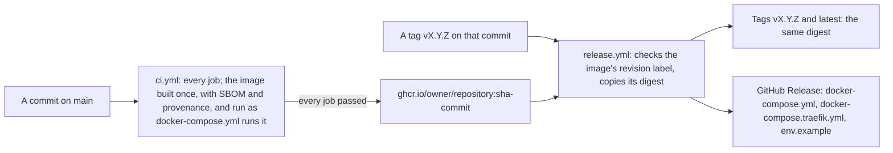

# Release and deploy a module

Purpose: take a module made from the template from a commit to a running deployment: release it, run it with Dokploy or plain Docker Compose, upgrade it, and tell which version runs.
Read this when: you release, deploy or upgrade a module, put a proxy in front of one, update a pinned action or image, or someone asks which version runs.
Related: [new module](new-module.md) (CI and the image), [configuration](configuration.md), [security checklist](security-checklist.md), [K18](../decisions/k18-a-release-promotes-the-tested-image.md), `template/.github/workflows/`, `template/docker-compose.yml`, `template/docker-compose.traefik.yml`.

A module is one image and one process on port 3001, speaking plain HTTP: TLS ends in front of it. The template ships the whole path below (built). Until the kit's first release a module's CI cannot install `@eneo-ai/module-kit` (the packed tarball in `web/vendor/` is not committed), so the path runs for a module from that release on ([new module](new-module.md#before-the-first-release)).

## From a commit to a release

Look at: one build per commit of main, and a release that only gives that build a name.



| Event | What happens | Source |
|---|---|---|
| A pull request | Every job; nothing is published. A newer push replaces the run | `ci.yml` |
| A push to main | The same jobs; then `publish` pushes the image the `image` job built and ran, by its digest, as `sha-<commit>`. A run on main is never cancelled | `ci.yml` |
| A tag `vX.Y.Z` on a commit of main | Waits for that commit's image while CI still runs (up to an hour), refuses an image whose `org.opencontainers.image.revision` label is another commit, gives the same digest the tags `vX.Y.Z` and `latest`, and creates the GitHub Release with the three files a deployment needs. It builds nothing | `release.yml` |

The image's name is the repository's, `ghcr.io/<owner>/<repository>` in lower case. The workflows derive it from the repository; `docker-compose.yml` names it, and CI's `compose` job fails until the two agree. That line is the one value a module sets for its releases.

To release, from a checkout of the module:

```bash
git tag v1.2.3 <a commit of main that CI has passed>
git push origin v1.2.3
```

A tag on a commit that is not on main fails at once. A tag pushed before CI has finished on its commit waits for the image: "Waiting for CI to publish" in the log is that wait, and the registry's "manifest unknown" is its cause. If CI fails on that commit, the release fails after an hour: fix main and tag the new commit.

The first publish creates the package in GitHub's container registry. Make it public in the package's settings, or give each host a login to `ghcr.io` with a token that can read packages.

## What the compose file runs

`docker-compose.yml` (built):

| Property | How |
|---|---|
| The image | `ghcr.io/<owner>/<repository>:${MODULE_VERSION}`, `latest` when unset |
| Its settings | `.env` beside the compose file, with the variables of [configuration](configuration.md). `MODULE_VERSION` also goes into the container, so that `/health` names the release |
| What it may write | Nothing but `/tmp`: the root file system is read-only, and `/tmp` is the volume `spool`, on disk, where an upload waits on its way to Eneo. Size it for `MAX_CONCURRENT_UPLOADS` × `MAX_UPLOAD_BYTES` |
| Privileges | No Linux capabilities, `no-new-privileges`, the image's non-root user (uid 10001) |
| Health | The image's `HEALTHCHECK`: `GET /health` on 3001, every 30 s |
| Port | 3001 on the compose network, none on the host |
| Restarts | `unless-stopped` |

`docker-compose.override.yml` is the developer's: it builds the image locally, publishes port 3001 and starts the stub Eneo. `docker compose up` merges it; `docker compose -f docker-compose.yml` and Dokploy do not.

## Dokploy

Dokploy runs `docker compose -p <app> -f <compose path> up -d`, so it reads `docker-compose.yml` alone, and its own Traefik ends TLS and routes the domain.

1. Create a Compose service of type Docker Compose: either from the module's repository (compose path `./docker-compose.yml`) or in the raw editor with `docker-compose.yml` from the release.
2. Under Environment, paste `env.example` from the release, filled in, with `MODULE_VERSION=vX.Y.Z`, `MODULE_PUBLIC_URL=https://<domain>` and `COOKIE_SECURE=true`. Dokploy writes the variables to `.env` beside the compose file, which the compose file reads.
3. Under Domains, add the domain on the service `module`, port 3001, with HTTPS from Let's Encrypt. Dokploy adds Traefik's labels and its network to the service.
4. Once per server, give Traefik the read timeout and HSTS of [Dokploy's Traefik](#dokploys-traefik).
5. Deploy, then [check it](#check-a-deployment).

## Plain Docker Compose

On a host without a reverse proxy, the overlay adds Traefik with HTTPS from Let's Encrypt, the read timeout and HSTS. Ports 80 and 443 must reach the host from the internet.

```bash
# in a folder with docker-compose.yml, docker-compose.traefik.yml and env.example from the release
cp env.example .env      # fill it in, with MODULE_VERSION=vX.Y.Z, MODULE_HOST, ACME_EMAIL,
                         # MODULE_PUBLIC_URL=https://<MODULE_HOST> and COOKIE_SECURE=true
docker compose -f docker-compose.yml -f docker-compose.traefik.yml up -d
```

On a host with a reverse proxy of its own, run `docker compose -f docker-compose.yml up -d`, and let the proxy reach `module:3001` on the compose network, or publish the port to the host alone in an override file of the host's own (`ports: ["127.0.0.1:3001:3001"]`). That proxy needs what the next section lists.

## What stands in front of the module

The module reads no `X-Forwarded-*` header and sets no HSTS. The proxy in front of it must have:

| Need | Why |
|---|---|
| HTTPS, with HSTS (`max-age=31536000`) | The session cookie is `Secure`: a browser sends it over HTTPS alone. The module speaks plain HTTP to the proxy |
| A read timeout that covers the slowest upload the module accepts | Traefik's read timeout covers the whole request, its body included, and its default of 60 s cuts every upload that takes longer to send. 1800 s carries 1 GiB over 5 Mbit/s |
| No body limit under `MAX_UPLOAD_BYTES` | A smaller one refuses uploads the module accepts |
| No access log of `/api/auth/callback` with its query | The query carries a one-time login ticket |

`docker-compose.traefik.yml` has the first two; `PROXY_READ_TIMEOUT` changes its read timeout.

### Dokploy's Traefik

Both settings are the server's Traefik's, once, for every service behind it.

1. The read timeout is static configuration. In `/etc/dokploy/traefik/traefik.yml` (in Dokploy's panel: Traefik File System), add `transport` to the entry points `web` and `websecure` that are there, and keep what they have:

   ```yaml
   entryPoints:
     web:
       transport:
         respondingTimeouts:
           readTimeout: 1800s
     websecure:
       transport:
         respondingTimeouts:
           readTimeout: 1800s
   ```

2. HSTS is a middleware in the dynamic configuration, `/etc/dokploy/traefik/dynamic/hsts.yml`:

   ```yaml
   http:
     middlewares:
       hsts:
         headers:
           stsSeconds: 31536000
   ```

   attached to `websecure` in `traefik.yml`, beside the read timeout:

   ```yaml
   entryPoints:
     websecure:
       http:
         middlewares:
           - hsts@file
   ```

3. Restart Traefik, which does not read its static configuration again by itself: `docker restart dokploy-traefik`.

## Upgrade and roll back

Set `MODULE_VERSION` to the new tag and deploy again. Compose stops the old container before it starts the new one, which the module needs: its sessions live in the process's memory, so everyone signs in again after the switch, and two containers at once would send people to the wrong one. Rolling back is the same with the earlier tag. Pin a tag: a host that already has an image tagged `latest` does not pull a newer one, and `latest` names no release.

## Which version runs

`<MODULE_PUBLIC_URL>/health` answers without a login:

```bash
curl -fsS https://modul.example.org/health
{"ok":true,"revision":"<the commit, 40 characters>","build_date":"2026-01-31T12:00:00Z","release":"v1.2.3","source":"https://github.com/eneo-ai/eneo-mod-example"}
```

| Field | What it is | `null` when |
|---|---|---|
| `release` | `MODULE_VERSION`, when it is a version tag `vX.Y.Z` | it is `latest`, `sha-<commit>`, unset or anything else, as in a local build (the development override sets it empty) |
| `revision` | The commit the image was built from | the image was built without CI's build arguments, as a local build is |
| `build_date` | When the image was built, in UTC: the build's time, not the release's or the deployment's | as `revision` |
| `source` | The repository the image was built from | as `revision` |

A signed-in person sees the same under Version in the account menu, and Kopiera supportinformation copies it, with the whole commit and the module's address, to paste into a report (the UI package's `VersionInfo`). Give `revision` in a report of a fault: it names the code exactly, also when the release is unknown. The image's labels say the same without starting it:

```bash
docker inspect --format '{{index .Config.Labels "org.opencontainers.image.revision"}}' ghcr.io/<owner>/<repository>:v1.2.3
```

The labels are `org.opencontainers.image.revision`, `org.opencontainers.image.created` and `org.opencontainers.image.source`. How the BFF reads the values: [configuration](configuration.md#which-build-runs).

## Check a deployment

- `/health` answers 200, with the release and the commit you deployed.
- In a private window, the sign-in goes through Eneo and back to the module's page with a clean address.
- `curl -sI <MODULE_PUBLIC_URL>/` shows HSTS from the proxy and the module's security headers.

## Keep the pins current

Everything CI and the image run is pinned: actions to a commit, images to a digest, packages in lock files with their hashes. Nothing updates itself. Update one kind at a time, monthly and when an advisory is published, and let CI pass in between; CI's `audit` job fails on a known advisory in the locks (`pip-audit`, and `npm audit` from high).

| Pin | Where | The new value |
|---|---|---|
| A GitHub Action | `uses:` in `.github/workflows/*.yml`: the commit, its release in the comment | `git ls-remote --tags https://github.com/actions/checkout 'refs/tags/v7.*'` |
| An image | `FROM` and the `# syntax` line in `Dockerfile`, `image:` in the compose files, the `registry` service and `SKOPEO` in the workflows | `docker buildx imagetools inspect python:3.12.15-slim-trixie --format '{{.Manifest.Digest}}'` (the tag beside the digest) |
| A tool CI installs | `pip install pip-audit==…` in the workflows | `pip index versions pip-audit` |
| The backend's packages | `backend/requirements.lock` | The command in its header |
| The web app's packages | `web/package-lock.json` | `npm install <package>@<version>` in `web/` |
